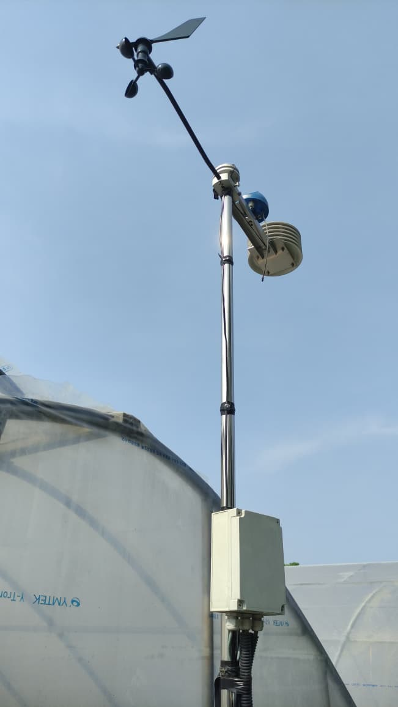
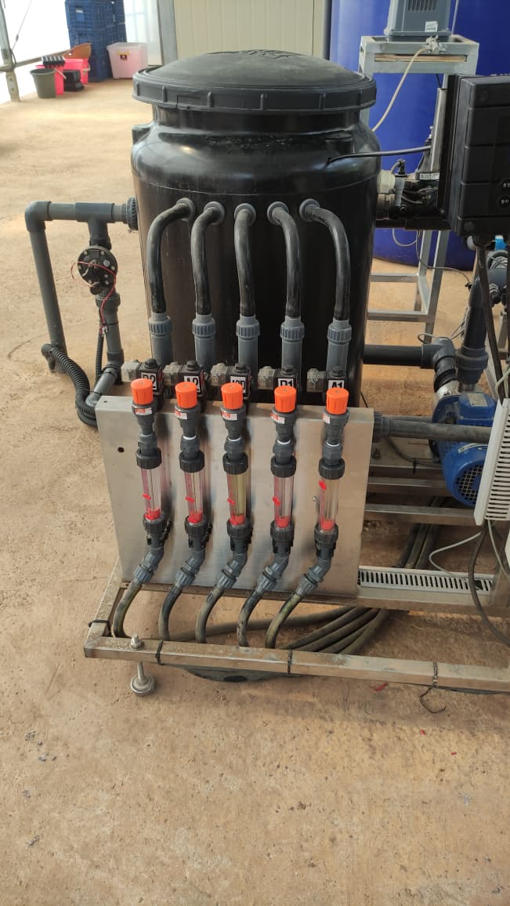
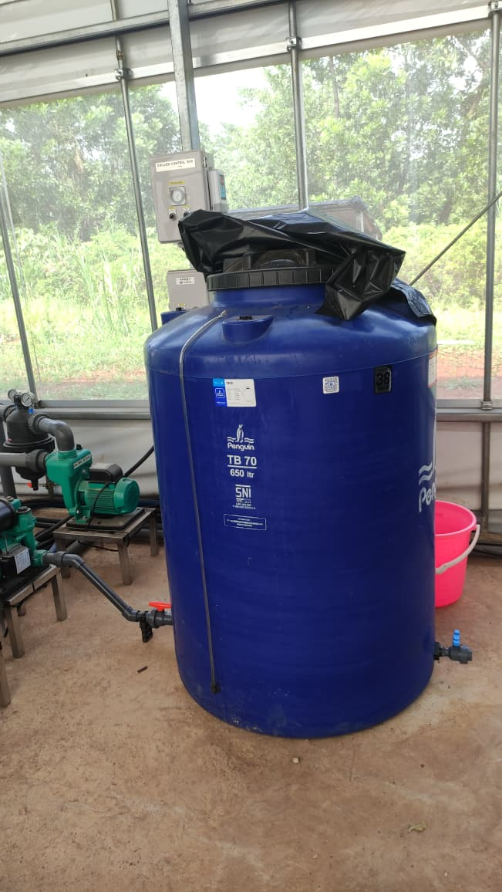
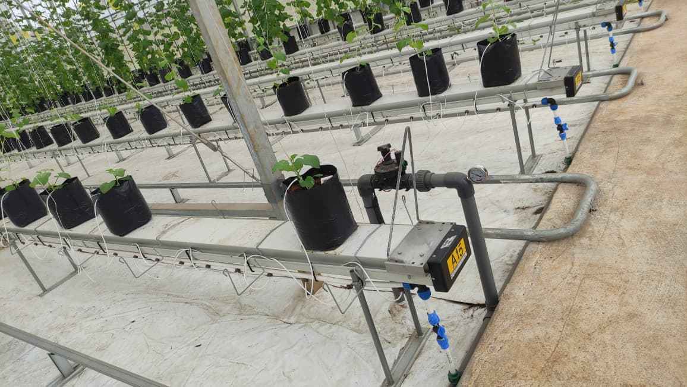
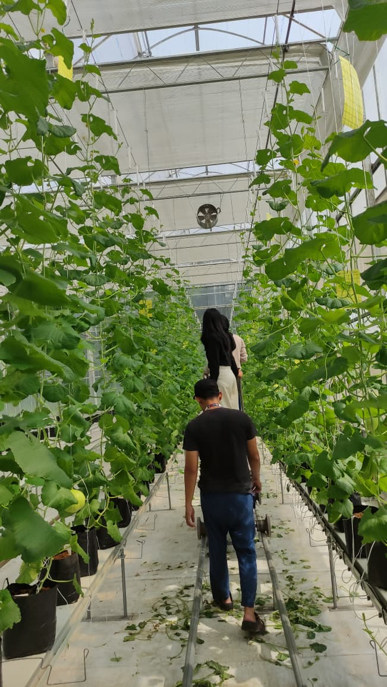

# Laporan Progress Harian MagangHub — 18 November 2026

> [!info] Ringkasan Kegiatan
> Pertemuan dan koordinasi dengan **Mr. Koh** dan **Mr. Lee** (KIST), orientasi teknis sistem kontrol lingkungan dan fertigasi pada fasilitas **BRIN–KIST Smart Greenhouse ODA Project**, serta kegiatan lapangan persiapan dan pemindahan media tanam *cocopeat* untuk budidaya melon.

---

## 1. Gambaran Umum Proyek & Dokumentasi Pertemuan

Fasilitas ini merupakan bagian dari **BRIN–KIST Smart Greenhouse ODA Project** (*The Project for Development of Smart Farm Technology in Jawa Barat, Indonesia*), hasil kolaborasi antara BRIN dan Korea Institute of Science and Technology (KIST).

*Tampak luar fasilitas Smart Greenhouse beserta spanduk BRIN–KIST Smart Greenhouse ODA Project.*

Pada hari ini dilakukan pertemuan langsung di dalam area *greenhouse* bersama **Mr. Lee** dan **Mr. Koh** terkait pengenalan sistem dan operasional budidaya.

> [!tip] Kontak & Rencana Tindak Lanjut dari Mr. Lee
> - **Email Mr. Lee:** `jyl7318@kist.re.kr` (untuk konsultasi dan pertanyaan teknis terkait sistem *Smart Greenhouse*).
> - **Rencana Bulan Desember:** Saat Mr. Lee kembali dari Korea pada bulan Desember mendatang, akan diberikan **modul sistem** untuk dipelajari dan digunakan lebih lanjut.

*Dokumentasi bersama Mr. Lee di dalam area tanam Smart Greenhouse.*

---

## 2. Sistem Kontrol Lingkungan (*Climate Control System*)

### A. Panel Kontrol Utama & Nursery
Panel kontrol utama mengatur aktuator lingkungan di dalam *greenhouse* secara otomatis maupun manual (*MAN/AUTO*), serta memiliki panel terpisah untuk area pembibitan (*nursery*).

*Panel kontrol utama (kiri), panel sistem nutrisi (merah), dan panel area nursery (kanan).*

Komponen yang dikendalikan meliputi:
- **Ceiling Windows (Left & Right):** Jendela atap yang membuka dan menutup untuk membuang udara panas dari dalam *greenhouse*.
- **Side Windows:** Jendela samping untuk sirkulasi udara; otomatis menutup saat hujan atau pada batas suhu tertentu.
- **Curtain (Tirai Atap):** Tirai peneduh otomatis yang **menutup pada suhu 35 °C** dan **membuka kembali pada suhu 34 °C**.
- **Ventilator:** Kipas pembuangan (*exhaust*) di bagian belakang/atas *greenhouse*.
- **Circulator:** Kipas sirkulasi udara yang menggantung di sepanjang lorong tanam (dilengkapi jalur cadangan).
- **Sistem Fogging (Pengabutan):** Terdapat 4 unit pengabut di dalam *greenhouse* yang aktif otomatis pada suhu tinggi (sekitar 35 °C) dengan siklus operasi **1 menit menyala, 10 menit mati** untuk menjaga suhu dan kelembapan.

### B. Automatic Weather Station (AWS)
Di luar *greenhouse* terpasang stasiun cuaca otomatis (*AWS*) yang datanya menjadi input bagi otomasi jendela dan tirai.

*Automatic Weather Station (AWS) di sisi luar greenhouse.*

Sensor yang terpasang pada AWS meliputi:
- **Anemometer & Wind Vane:** Mengukur kecepatan dan arah angin.
- **Sensor Cahaya / Radiasi Matahari:** Mengukur intensitas cahaya di luar *greenhouse*.
- **Sensor Suhu & Kelembapan Udara:** Berada di dalam *radiation shield* putih.

---

## 3. Sistem Irigasi, Fertigasi, & Kontrol Nutrisi

### A. Panel Kontrol Nutrisi & Katup (*Otak Sistem*)
Sistem fertigasi dan irigasi dikendalikan oleh unit kontrol yang dikembangkan oleh **Mr. Lee**.

*Panel kontrol sistem nutrisi (Nutrient System), saklar katup (Valve V1–V10), dan unit kontrol digital.*

- **Nutrient System:** Mengontrol *power*, *filling pump*, *system pump*, injeksi larutan **A1, B1, C (Acid), A2, B2**, serta **Agitator 1 & 2** dalam mode `MAN / AUTO`.
- **Valve Control (V1–V10):** Mengatur pembukaan katup distribusi ke masing-masing zona/jalur tanam.
- **Monitoring Sensor:** Dilengkapi sensor **EC** (*Electrical Conductivity*) dan **pH** untuk memantau kepekatan serta keasaman larutan nutrisi sebelum dialirkan.

### B. Tangki Stok Nutrisi & Unit Pencampuran (*Mixing*)
Nutrisi yang digunakan adalah pupuk **AB Mix** dengan formula awal dari pihak Korea, yang ke depannya dapat diracik mandiri sesuai kebutuhan fase pertumbuhan tanaman.

*Tangki stok larutan nutrisi A1, B1 (dilengkapi motor pengaduk/agitator), dan Acid.*

*Tangki pencampur (mixing tank) dengan 5 saluran katup solenoid (B2, A2, Acid, B1, A1) dan flowmeter.*

### C. Manajemen Air Baku, Chiller, & Pompa Distribusi
Sumber air operasional *greenhouse* berasal dari **dua sumber**, yaitu **air sumur** dan **pemanenan air hujan (*rainwater harvesting*)** yang ditampung dari talang atap *greenhouse* ke toren penampungan sebagai cadangan saat kemarau.

*Tangki air berinsulasi (B260812A) yang terhubung ke sistem chiller untuk menjaga suhu air tetap dingin.*

*Rangkaian pompa distribusi bertekanan (non-gravitasi), tabung filter/softener, dan katup kontrol irigasi.*

*Toren penampungan air utama beserta pompa aerator dan dosing.*

*Tangki kapasitas 650 liter (Penguin TB 70) dan Chiller Control Box di bagian belakang.*

### D. Sistem Irigasi Tetes (*Drip Irrigation*) di Jalur Tanam
Sistem irigasi tetes (*drip irrigation*) pada meja/jalur tanam saat ini beroperasi secara **semi-otomatis berbasis waktu** (*time-based*).
- Terdapat **katup (*valve*)** pada setiap jalur (seperti terlihat pada jalur **A13** dan **A14**) yang berfungsi untuk mengatur dan membatasi aliran air ke tanaman.
- Jalur **A13** dan **A14** berasal dari **dua inputan tangki yang berbeda**, serta dilengkapi *pressure gauge* dan katup kontrol pada jalur distribusi utama (terlihat pada jalur **A15**).

*Jalur irigasi tetes A14 dengan katup biru pembatas aliran air.*

*Jalur irigasi tetes A13 dari inputan tangki yang berbeda dengan katup pembatas aliran air.*

*Rangkaian distribusi irigasi tetes pada jalur tanam (termasuk jalur A15, katup kontrol, dan pressure gauge).*

---

## 4. Aktivitas Lapangan & Budidaya Melon

### A. Kondisi Area Tanam
Tanaman utama yang sedang dibudidayakan adalah **melon** dalam polybag menggunakan sistem irigasi tetes (*drip irrigation*) dan tali rambat vertikal.

*Area dalam greenhouse: barisan tanaman melon, kipas sirkulator di atas, tirai atap, dan trolley di atas rel pipa.*

### B. Pemindahan Media Tanam Cocopeat & Sterilisasi
Kegiatan fisik yang dilakukan hari ini adalah memindahkan dan menata **polybag putih berisi media *cocopeat*** ke jalur meja tanam menggunakan *trolley* rel (dengan penyesuaian jarak tanam sekitar 45 cm dan penyeragaman warna polybag putih).

.jpeg)
*Kegiatan pemindahan polybag media tanam cocopeat menggunakan trolley rel.*

Catatan teknis terkait media *cocopeat*:
- **Cocopeat Baru:** Harus direndam terlebih dahulu untuk menghilangkan **zat tanin** yang dapat menghambat pertumbuhan akar.
- **Cocopeat Bekas Pakai:** Disterilisasi ulang dengan merendamnya menggunakan larutan **$\text{H}_2\text{O}_2$ (Hidrogen Peroksida)** sebelum digunakan kembali pada siklus tanam berikutnya.
- **Evaluasi Persemaian & Penyakit:** Dilakukan diskusi bersama rekan magang (bidang proteksi tanaman) terkait pemantauan hama/penyakit melon serta catatan bahwa tingkat perkecambahan pada persemaian sebelumnya masih rendah (< 50%, sekitar 20%).

### C. Penyemaian & Varietas Benih Melon
Dilakukan kegiatan persiapan dan penyemaian (perkecambahan) benih melon bersama tim di dalam ruangan menggunakan wadah plastik, tisu lembap, dan *sprayer*.

*Proses persiapan dan penyemaian benih melon bersama tim.*

Terdapat **3 varietas benih melon F1 Hybrid** yang disiapkan untuk disemai:
1. **Inthanon RZ** (*Rijk Zwaan*, F1-Hybrid `34-248`) — benih berlapis warna kuning.
2. **Golden Langkawi S208** (*Known-You Seed*, F1 Hybrid Melon) — benih berwarna krem alami (kulit kuning emas, daging buah putih, kadar gula ±16–18%, panen 65–70 hari).
3. **Sweet Net #9** (*Advance Seeds*, Hybrid Melon Seed) — benih berlapis warna merah muda/pink (kulit berjaring, daging oranye renyah, kadar gula 14–16 Brix, berat 1,8–2,5 kg, panen 65–70 hari).

*Tiga varietas benih melon yang disemai: Inthanon RZ, Golden Langkawi S208, dan Sweet Net #9.*

---

## 5. Makan Siang Bersama Tim & Dr. Lee
Pada siang hari, dilakukan makan siang bersama **Dr. Lee**, **Mr. Koh**, tim lapangan, dan rekan-rekan magang. Pada kesempatan ini tim ditraktir menu **tongseng sapi**.

*Makan siang bersama Dr. Lee, Mr. Koh, dan tim Smart Greenhouse.*

*Menu tongseng sapi yang ditraktir saat makan siang bersama.*

---

## 6. Tindak Lanjut (*Next Steps*)
- [ ] Menghubungi Mr. Lee via email (`jyl7318@kist.re.kr`) apabila ada pertanyaan teknis mengenai sistem *Smart Greenhouse*.
- [ ] Memantau pengoperasian sistem kontrol lingkungan dan jadwal fertigasi pada komputer/sistem kontrol utama bersama tim lapangan.
- [ ] Mengamati perkembangan tanaman melon serta mencatat parameter EC, pH, dan suhu harian.
