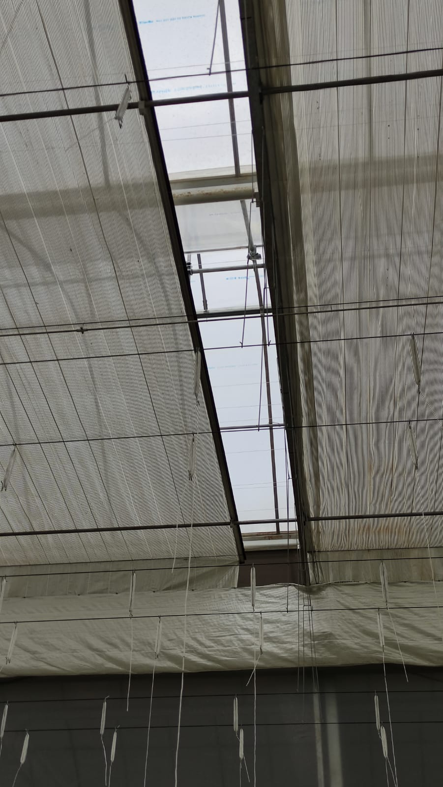

# Laporan Progress Harian MagangHub — Day 2 (19 November 2026)

> [!NOTE] Ringkasan Kegiatan
> Melanjutkan pemindahan dan penataan polybag di jalur tanam pada pagi hari, diikuti pendampingan keliling area dalam *greenhouse* bersama **Mas Ahmad**, **Naswa**, dan **Acel** untuk mempelajari sistem sensor berat polybag, sensor nutrisi limbah (*drain*), sensor kelembapan/suhu ruangan, serta sistem *fogging*.

---

## 1. Kegiatan Pagi: Pemindahan Polybag & Pemasangan Selang Drip
Pada pagi hari (sekitar pukul 08.17 WIB), dilakukan pemindahan dan penataan polybag berisi media tanam *cocopeat* di atas talang/meja tanam *Smart Greenhouse*.

*Proses pemindahan dan penataan polybag di jalur meja tanam Smart Greenhouse.*

Setelah polybag tertata, dilanjutkan dengan **pemasangan selang dan penancapan stik drip (*dripper*)** ke masing-masing polybag, sekaligus **pengecekan di setiap petak/jalur** untuk memastikan aliran drip berjalan lancar dan **tidak ada kebocoran** pada selang maupun sambungan.

.jpeg)
*Pemasangan selang dan pengecekan jalur drip pada barisan polybag.*

*Penancapan emitter/stik drip langsung ke media tanam cocopeat dan pengecekan kebocoran.*

---

## 2. Keliling Greenhouse Bersama Mas Ahmad, Naswa, & Acel
Setelah penataan polybag, dilakukan peninjauan langsung (*walkthrough*) bersama **Mas Ahmad**, **Naswa**, dan **Acel** untuk memahami cara kerja sensor-sensor pemantauan di dalam *greenhouse*.

*Diskusi dan penjelasan teknis sensor-sensor greenhouse bersama Mas Ahmad, Naswa, dan Acel.*

---

## 3. Sistem Sensor Berat & Nutrisi Limbah (*RMFarm Main / IReIS*)

Pada salah satu jalur tanam terdapat unit timbangan dan sensor otomatis berlabel **`RMFarm Main` (`IReIS`)** yang terhubung ke sistem **RM Farm** untuk memantau kondisi media dan larutan nutrisi secara otomatis.

### A. Sensor Berat (*Load Cell*) — Sampel 2 Polybag
- Unit timbangan ini mengukur berat total (`kg`) dari **2 polybag sampel** yang diletakkan di atas pelat timbangan khusus.
- Hanya 2 polybag yang dipasang pada sensor karena sudah **mewakili keseluruhan grup irigasi** (suplai nutrisi dan debit irigasi pada satu grup sama).

*Dua polybag sampel yang diletakkan di atas unit sensor berat.*

*Detail pelat sensor berat (load cell) dan panel display digital RMFarm Main.*

### B. Sensor Nutrisi Limbah / Drainase (EC, pH, & Suhu)
Air/nutrisi sisa (*drain*/limbah) yang keluar dari 2 polybag sampel tersebut dialirkan melewati kotak sensor sebelum dibuang, untuk mengukur secara otomatis:
- **EC (`mS`):** Kepekatan larutan nutrisi sisa (*Electrical Conductivity*).
- **pH:** Tingkat keasaman larutan limbah.
- **Suhu (`°C`):** Suhu air limbah nutrisi.

Data dari sensor **EC, pH, suhu limbah, berat polybag, dan kelembapan** langsung masuk dan tercatat otomatis ke sistem **RM Farm**.

*Unit sensor EC dan pH untuk memantau larutan limbah/drainase serta panel display RMFarm Main (mS, pH, Kg, °C).*

---

## 4. Sensor Suhu & Kelembapan Udara di Dalam Greenhouse
Di dalam area tanam tergantung kotak sensor iklim mikro (*wet-bulb / psychrometer* dengan kipas kecil dan sumbu kain pada wadah air) yang terhubung ke sistem kontrol utama.

*Kotak sensor suhu dan kelembapan udara (dilengkapi kipas sirkulasi dan wadah air bersumbu).*

> [!IMPORTANT] Catatan Perawatan Rutin
> Wadah air di dalam kotak sensor ini **harus rutin dicek dan diisi air** agar sumbu tetap basah dan sensor dapat mendeteksi kelembapan secara akurat (pada pengecekan hari ini airnya dalam kondisi habis sehingga perlu diisi ulang).

---

## 5. Sistem *Fogging* (Pengabutan) & Ventilasi Atap
Mas Ahmad juga menjelaskan lokasi serta mekanisme kerja **sistem *fogging*** yang terpasang di bagian atas *greenhouse*:
- Pipa dan *nozzle fogging* berada di bagian atas di atas jalur tanam.
- Menyala **otomatis saat suhu mencapai 35 °C** untuk menurunkan suhu dan menjaga kelembapan udara di dalam *greenhouse*.
- Durasi sekali penyemprotan sekitar **1 menit 50 detik**.

*Tampak bagian atas greenhouse dengan celah tirai/ventilasi atap dan jalur sistem fogging.*

---

## 6. Tindak Lanjut (*Next Steps*)
- [ ] Rutin mengecek dan mengisi ulang air pada kotak sensor kelembapan di dalam *greenhouse*.
- [ ] Memantau pembacaan **EC (`mS`), pH, berat (`Kg`), dan suhu (`°C`)** pada unit `RMFarm Main` dan komputer utama RM Farm.
- [ ] Memastikan seluruh polybag pada jalur tanam tertata rapi dan siap untuk tahap penanaman berikutnya.
